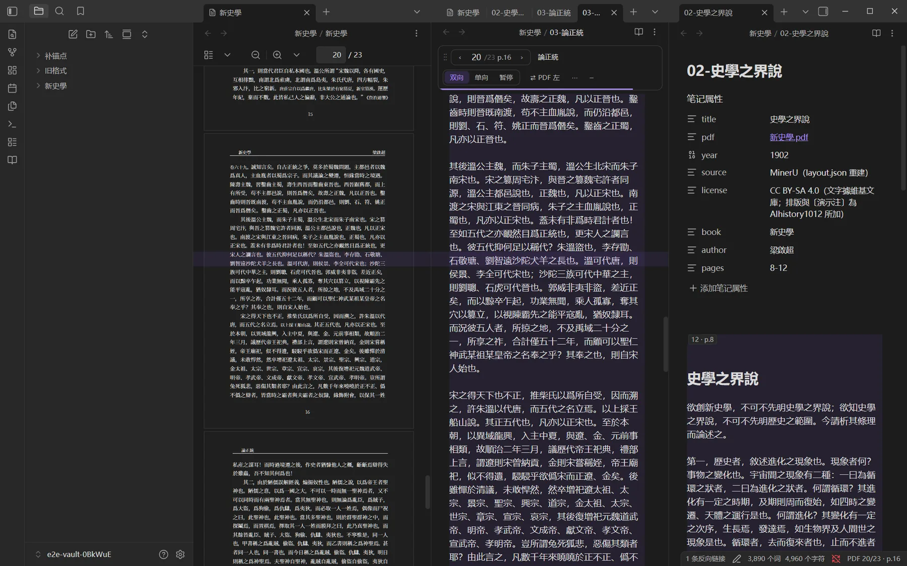
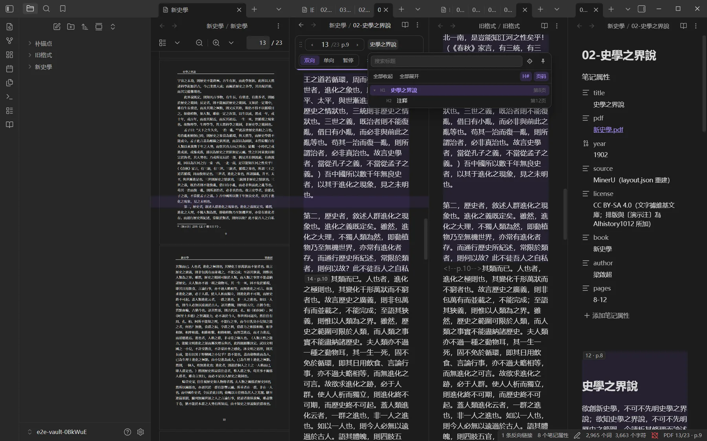
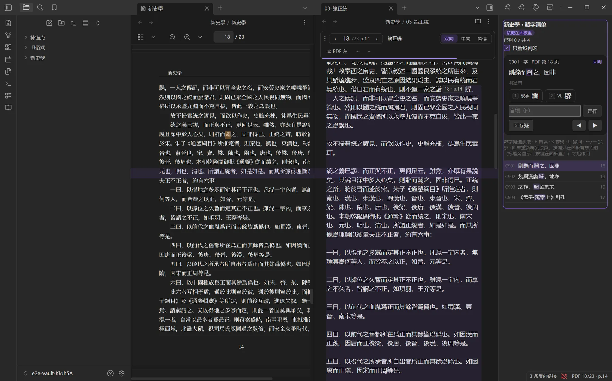
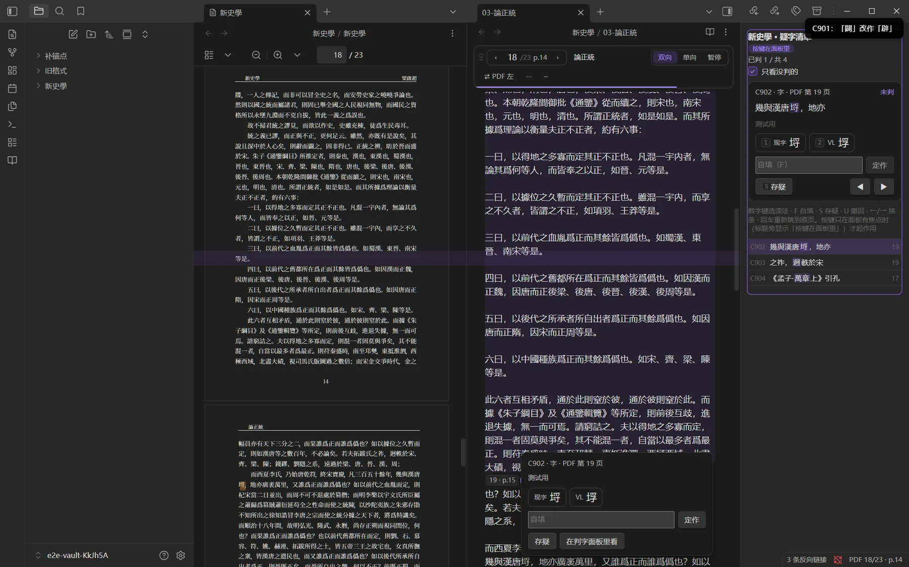
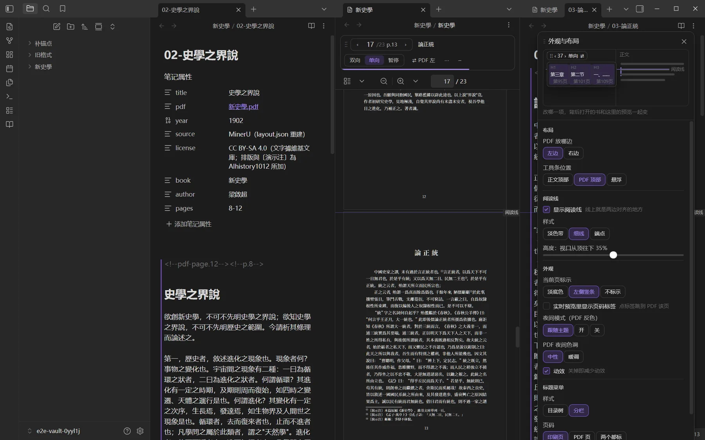

# PDF Sync Markdown

**对照原书 PDF 阅读、校改 Markdown 的 Obsidian 插件。**
**An Obsidian plugin for reading and proofreading a Markdown transcription side by side with its source PDF.**

一边是 Obsidian 内置的 PDF 阅读器，一边是原生 Markdown 编辑器：读到哪页，PDF 跟到哪页；在正文里选几个字，PDF 上高亮同一处；按页校改，判定识别不准的字。

The source PDF opens in Obsidian's built-in viewer, next to the transcription in the native editor. The PDF follows whatever page you are reading, selected text is highlighted in the PDF, and you can correct the text page by page and resolve characters the OCR was unsure about.

> 界面目前只有中文。The interface is currently in Chinese only.
> 仅限桌面版。Desktop only.


---

## 功能 / Features

### 按页跟随、逐字高亮 / Page sync and text highlighting

滚动正文，PDF 翻到同一页、同一行；滚动 PDF，正文也跟过来（可切成「单向」或「暂停」）。在正文里选中一句，PDF 上同一句高亮；在 PDF 上选字，正文选中同一段。

Scroll the text and the PDF turns to the same page and line; scroll the PDF and the text follows (switch to one-way or pause at any time). Select a sentence in the text and the same words light up in the PDF; select in the PDF and the matching text is selected.


### 阅读线与逐行对齐 / Reading line and line-level alignment

两边在同一高度标出一条「阅读线」，线上就是正文与 PDF 对齐的那一行。插件按 PDF 文字层逐行比对，页眉、页码、页下注自动跳过，文字层有错字也认得出行。没有文字层的扫描页退回按页跟随。点「暂停」时阅读线随之收起。

A reading line is drawn at the same height in both panes; whatever sits on it is aligned. Alignment is computed line by line against the PDF text layer, skipping running heads, page numbers and footnotes, and tolerating OCR errors. Pages without a text layer fall back to page-level sync. The line disappears while sync is paused.



### 工具条与标题菜单 / Toolbar and heading menu

工具条可停在正文或 PDF 顶部，也可拖出来悬浮。上面显示页码、印刷页、当前所在的各级标题；点标题弹出目录树或分栏菜单，可搜索、钉住，点哪个标题两边一起跳过去。

The toolbar docks above either pane or floats. It shows the PDF page, the printed page and the current heading path. Click the headings to open a tree or column menu with search and pinning; picking a heading moves both panes there.



### 判字 / Resolving uncertain characters

两家 OCR 读法不同、AI 也定不了的字记在「疑字清单」里。在右侧栏的判字面板里逐条看截图、上下文和各家读法，按数字键选定；也可以直接在正文里把鼠标停在带波浪线的字上判。定字后插件改正文那个字、勾掉清单、在校注里补一行，都可撤回。

Characters the two OCR engines disagree on are listed in a suspect list. Review them one by one in the side panel, with the crop, context and each reading, and pick with a number key; or hover a wavy-underlined character in the text. Resolving one updates the text, ticks the list and logs it in the notes; every step can be undone.

| 判字面板 / Suspect panel | 正文里的悬停卡片 / Hover card in the text |
|---|---|
|  |  |

### 外观与布局 / Look and layout

「外观与布局」是一个不挡界面的浮动面板：PDF 放哪边、工具条位置、阅读线样式与高度、当前页标示、页码标签、夜间模式、标题菜单样式，点了立刻生效，背后的书当场变样；可一键撤回本次改动。从设置页顶部、工具条 ⋯ 菜单或命令「外观与布局」打开。

The Look and layout panel floats without blocking the workspace. PDF side, toolbar position, reading-line style and height, current-page marker, page labels, night mode and heading-menu style apply instantly to the open book, and one click undoes the session's changes. Open it from the top of the settings tab, the toolbar ⋯ menu, or the command 外观与布局.



### 其他 / Also

- **按页修订请求 / Per-page revision request**：整段丢了、脚注错位、表格坏了，点「复制本页修订请求」，粘给 AI，让它对照原页只改这一页。Copy a request for the current page and paste it to an AI that fixes only that page against the original.
- **补页码锚点 / Add page anchors**：给没有锚点的笔记按 PDF 补上，先预览再写入，正文一字不改。Insert missing page anchors after a preview; the text itself is not changed.
- **夜间模式 / Night mode**：PDF 页面反色成深底浅字，可跟随主题，色调可选中性或暖调。Inverts PDF pages for dark themes, with a neutral or warm tone.
- **配对检查 / Pairing check**：PDF 在 Obsidian 外改名或挪动，插件会提示重新配对，核对清单后才写入。If the PDF is renamed or moved outside Obsidian, the plugin offers to re-pair, writing only after you confirm.

---

## 怎么配对 / How a note is paired with its PDF

插件只认两样东西：笔记 frontmatter 里的 `pdf: "[[原件.pdf]]"`，以及正文里的页码锚点 `<!--pdf-page.N-->`（PDF 第 N 页从这里开始，后面可跟印刷页 `<!--p.M-->`）。约定全文见 [docs/anchors.md](docs/anchors.md)。

The plugin relies on two things: `pdf: "[[source.pdf]]"` in the note's frontmatter, and page anchors `<!--pdf-page.N-->` in the text (PDF page N starts here, optionally followed by a printed page `<!--p.M-->`). See [docs/anchors.md](docs/anchors.md) for the full convention.

这样的 Markdown 可以用配套的 agent skill **book2md1012** 生成：把论文、专著、教材或现代排版古籍的 PDF 交给 AI，由两家 OCR 交叉核对，整理成逐页对得回原书的 Markdown（[1012-web/AIHIST-skills-1012](https://github.com/1012-web/AIHIST-skills-1012)）。已有的 Markdown 也能用：在工具条 ⋯ 菜单里配对 PDF，用命令补上页码锚点即可。

Such Markdown can be produced with the companion agent skill **book2md1012**, which cross-checks two OCR services and returns Markdown that maps back to the book page by page ([1012-web/AIHIST-skills-1012](https://github.com/1012-web/AIHIST-skills-1012)). Existing Markdown works too: pair a PDF from the toolbar ⋯ menu and add page anchors with the command.

## 命令 / Commands

| 命令 | Command |
|---|---|
| 在旁边打开配对的 PDF | Open the paired PDF alongside |
| 上一页 / 下一页（正文与 PDF 一起翻） | Previous / next page in both panes |
| 暂停或恢复跟随 | Pause or resume sync |
| 复制本页修订请求 | Copy the revision request for this page |
| 补页码锚点（预览后写入） | Add page anchors (with preview) |
| 打开判字面板 | Open the suspect panel |
| 外观与布局 | Look and layout |
| 重新打开引导 | Reopen the welcome guide |
| 给这本书配对 PDF | Pair this book with a PDF |

## 安装 / Installation

**社区插件市场 / Community plugins**：上架后在「设置 → 第三方插件 → 浏览」里搜索 PDF Sync Markdown。Once listed, search for PDF Sync Markdown in Settings → Community plugins → Browse.

**手动 / Manual**：从 [Releases](https://github.com/1012-web/pdf-sync-markdown/releases) 下载 `main.js`、`manifest.json`、`styles.css`，放进库里的 `.obsidian/plugins/aihistory-pdf-sync/`，在「设置 → 第三方插件」里启用。Download `main.js`, `manifest.json` and `styles.css` from Releases into `.obsidian/plugins/aihistory-pdf-sync/` in your vault, then enable the plugin.

第一次启用会弹四步引导，之后在设置页或「外观与布局」面板里改。The first launch shows a four-step guide; change things later in the settings tab or the Look and layout panel.

## 会改动编辑区样子的设置 / Settings that change the editor's look

以下默认开，引导和设置里都能关：实时预览里把页码锚点显示成小标签；当前页加淡底色（或左侧竖条）；没判的疑字画波浪下划线。插件不改默认编辑模式，样式只作用于插件自己的元素。

On by default and switchable off in the guide or settings: page anchors shown as small labels in Live Preview, a tint (or left bar) on the current page, and wavy underlines on unresolved characters. The plugin does not change your default editing mode; its styles apply only to its own elements.

## 隐私 / Privacy

插件不联网，不收集任何数据，只读写库内文件。它写入的只有你逐条点过的内容：判字结果、补的页码锚点、配对时写进 frontmatter 的 `pdf` 字段，写前都先给你看清单或预览。OCR 和上传 PDF 只发生在 skill 那一侧。

The plugin makes no network requests, collects no data and only reads and writes files inside your vault. It writes only what you explicitly confirm: resolved characters, added page anchors, and the `pdf` frontmatter field when pairing, each shown to you first. OCR and any PDF upload happen only on the skill side.

## 开发 / Development

```bash
cd obsidian
npm install
npm run build      # 产物在 dist/ · output in dist/
npm run check      # 类型检查、eslint、单测 · typecheck, lint, unit tests
npm run test:e2e   # 在独立下载的 Obsidian 里跑端到端测试 · end-to-end tests in a separate Obsidian
```

代码分层见 [obsidian/README.md](obsidian/README.md)，维护约定见 [AGENTS.md](AGENTS.md)，已知问题见 [docs/known-issues.md](docs/known-issues.md)（中文）。
Code layout: [obsidian/README.md](obsidian/README.md); maintenance notes: [AGENTS.md](AGENTS.md); known issues: [docs/known-issues.md](docs/known-issues.md) (in Chinese).

## 截图说明 / About the screenshots

截图均为插件在 Obsidian 里的实际界面，由端到端测试在独立的测试库里拍摄。演示文字为梁启超《新史學》，据维基文库，CC BY-SA 4.0；演示书按真实流程排印成扫描件、用 book2md1012 导入。截图同按 CC BY-SA 4.0 释出。

All screenshots are the plugin's real interface in Obsidian, captured by the end-to-end tests in a separate test vault. The demo text is Liang Qichao's *Xin Shixue* (新史學) from Wikisource, CC BY-SA 4.0, typeset as a scanned book and imported with book2md1012. The screenshots are released under CC BY-SA 4.0 as well.

## 致谢 / Acknowledgements

- [PDF Collation](https://github.com/HongdongLee/obsidian-pdf-collation)（及网页版 [Collatio](https://hongdonglee.github.io/obsidian-pdf-collation/)）：本插件移植了它的文字匹配算法（MIT，见 [THIRD_PARTY_NOTICES.md](THIRD_PARTY_NOTICES.md)），并借鉴了基准线跟随、阅读线与工具条的设计。两者路线不同：本插件用 Obsidian 原生编辑器和内置 PDF 阅读器；想要独立的校勘视图，可以试试 PDF Collation。
  The text-matching algorithm is ported from PDF Collation (MIT), and its baseline sync, reading line and toolbar inspired this plugin's design. PDF Collation offers a dedicated collation view; this plugin works inside Obsidian's native editor and PDF viewer.
- [PDF.js](https://mozilla.github.io/pdf.js/)、[CodeMirror](https://codemirror.net/)、[React](https://react.dev/)、[Base UI](https://base-ui.com/)、[Motion](https://motion.dev/)。

## 许可 / License

MIT，见 [LICENSE](LICENSE)；第三方代码见 [THIRD_PARTY_NOTICES.md](THIRD_PARTY_NOTICES.md)。
MIT, see [LICENSE](LICENSE); third-party code is listed in [THIRD_PARTY_NOTICES.md](THIRD_PARTY_NOTICES.md).
