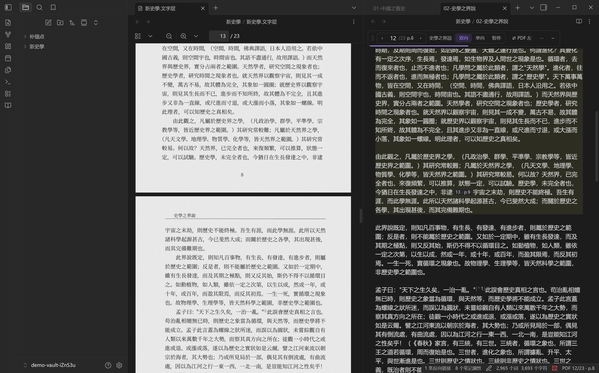
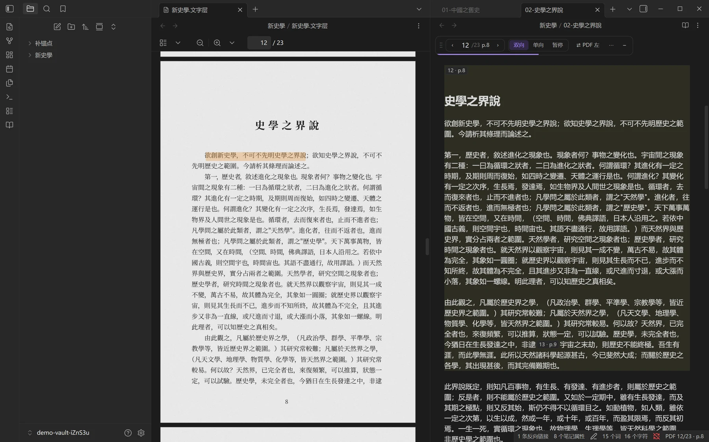
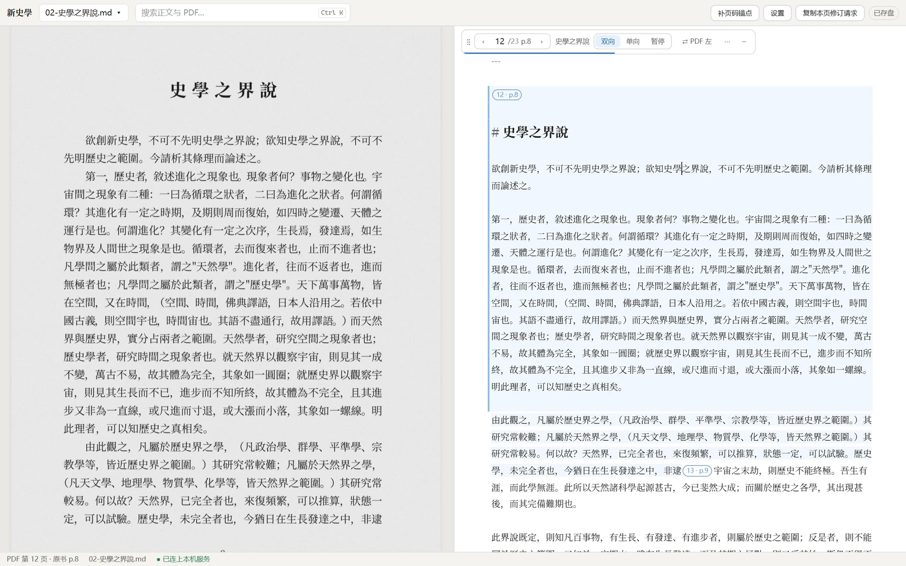

# PDF Sync Markdown

作者自制的 Obsidian 插件：左边原 PDF、右边 Markdown 正文，读到哪页跟到哪页，选字在 PDF 上逐字高亮，按页校改。另附一个本机网页工作台，给不用 Obsidian 的人。

它读的书，由配套的 agent skill **book2md1012** 整理：把论文、专著、教材及现代排版古籍的 PDF 交给 AI，MinerU 与 PaddleOCR 两家云端识别交叉核对，整理成逐页对得回原书的 Markdown。skill 在另一个仓库：[1012-web/AIHIST-skills-1012](https://github.com/1012-web/AIHIST-skills-1012)。

**线上预览（暂停）**：仓库改为私有后 GitHub Pages 未再发布，2026-10-28 起 <https://pdf2md.1012.wiki/> 访问为 404；恢复前请在本机跑 `npm run demo:serve` 看效果。原本 `/demo/` 是只读演示站（自带公版《新史學》样例书，能翻页、对照、选字高亮、搜索，不能存盘）。主页在 `site/`，演示站由 `web/` 静态导出，`.github/workflows/pages.yml` 推 main 就重建。

本仓库装两样东西：

| 东西 | 干什么 | 给谁用 |
|---|---|---|
| **Obsidian 插件 `aihistory-pdf-sync`**（PDF Sync Markdown，`obsidian/`） | 左 PDF、右正文对照，按页跟随，选字逐字高亮，按页校改 | 用 Obsidian 的人 |
| **网页工作台**（`web/`） | 同样的对照阅读与校改，在本机浏览器里打开一本书的文件夹 | 不用 Obsidian 的人 |

插件、网页与 skill 只靠一套约定连着：正文里的物理页锚点 `<!--pdf-page.N-->`（PDF 第 N 页的起点）、印刷页锚点 `<!--p.M-->`、frontmatter（文件开头的属性区）里的 `pdf: "[[原件.pdf]]"`，以及 `_数据/book.json`。约定全文见 [docs/anchors.md](docs/anchors.md)（副本，唯一源在 skill 仓库）。阅读工具不识字、不改内容；改内容的是对话里的 AI。

## 截图

| 对照阅读、按页跟随 | 逐字高亮 | 网页工作台 |
|---|---|---|
|  |  |  |

演示文字为梁启超《新史學》，据维基文库，CC BY-SA 4.0。演示书按真实流程排印成扫描件、用 `book2md1012` 导入后拍摄；截图同按 CC BY-SA 4.0 释出。

## 怎么用

1. **整理书**：先装 skill（见 [AIHIST-skills-1012](https://github.com/1012-web/AIHIST-skills-1012)），在对话里说「把这份 PDF 导入成 Markdown，放进我的 Obsidian 库」。
2. **对照阅读、手改小错**：在 Obsidian 里打开这本书，左边原件、右边正文。可以直接在 Markdown 编辑视图修改并保存；需要重新关联 PDF 时，在插件工具条「⋯ → 配对：…（点击改绑）」选择 PDF 并核对笔记清单。一般改字无需改绑，改绑不会把 Markdown 改字写回 PDF 文字层。疑字清单里的每一条都是链接，点一下跳到那一页那个字。
3. **大错交 AI 按原页修**：整段丢了、脚注错位、表格坏了，在工具条点「复制本页修订请求」，粘给装了 book2md1012 的 AI。AI 对照 PDF 原页只改这一页，锚点不动。

## 安装

### Obsidian 插件

正在提交 Obsidian 社区插件市场；上架前先手动安装：从 [Releases](https://github.com/1012-web/pdf-sync-markdown/releases) 下载 `main.js`、`manifest.json`、`styles.css`，放进库里的 `.obsidian/plugins/aihistory-pdf-sync/`，在「设置 → 第三方插件」里启用。装了 book2md1012 的 AI 首次引导时也会代你做这一步。

想新建一个专门读书的库：新建文件夹，把仓库里的 `vault-template/.obsidian/` 复制进去，再放好上面的插件目录，在 Obsidian 里「打开文件夹作为库」。

也可以自己构建：

```bash
cd obsidian
npm install
npm run build
```

产物在 `obsidian/dist/`。第一次启用会弹四步引导（布局、联动、外观、开始），以后在插件设置页里改。

### 网页工作台

需要 Node.js 24 或更新。

```bash
cd web
npm install
npm run workbench -- "D:\书\某本书"
```

第一次会先构建界面（一两分钟），之后秒开，自动用默认浏览器打开。只监听本机（127.0.0.1），网址带令牌；编辑自动存回硬盘，Claude 在硬盘上改了文件网页立刻刷新，两边同时改了会弹出差异让你选，绝不静默覆盖。详见 [web/README.md](web/README.md)。

## 隐私

Obsidian 插件与网页工作台不联网。识别、上传 PDF 只发生在 skill 那一侧，说明见 skill 仓库。

## 文档

- [docs/anchors.md](docs/anchors.md)：锚点、frontmatter、书文件夹、`book.json`、疑字清单链接、修订请求格式。skill 与阅读工具之间唯一的接口（副本）。
- [docs/division-of-labor.md](docs/division-of-labor.md)：脚本、AI、用户的分工（副本）。
- [docs/known-issues.md](docs/known-issues.md)：已知问题。
- [obsidian/README.md](obsidian/README.md)：插件的代码分层与开发。
- [AGENTS.md](AGENTS.md)：维护约定。

## 测试

```bash
cd obsidian && npm run check       # 插件：类型检查、eslint、单测
cd obsidian && npm run test:e2e    # 插件：在独立下载的 Obsidian 里跑端到端测试
cd web && npm test                 # 网页：单测
cd web && npm run test:e2e         # 网页：Playwright 端到端测试
```

样例书用仓库里的公版《新史學》（`tests/fixtures/`）现造。

## 致谢 / 相关项目

- [PDF Collation](https://github.com/HongdongLee/obsidian-pdf-collation)（Obsidian 插件）与它的网页版 [Collatio](https://hongdonglee.github.io/obsidian-pdf-collation/)。本仓库移植了它的文字匹配算法（MIT 许可，版权声明见 [THIRD_PARTY_NOTICES.md](THIRD_PARTY_NOTICES.md)），并借鉴了它的基准线跟随和工具条的设计思路。两者是不同的路线：本插件用 Obsidian 原生编辑器和内置 PDF 阅读器，配合 book2md1012 skill；如果你更喜欢独立的校勘视图，可以试试 PDF Collation。
- [PDF.js](https://mozilla.github.io/pdf.js/)、[CodeMirror](https://codemirror.net/)、[React](https://react.dev/)、[Base UI](https://base-ui.com/)、[Motion](https://motion.dev/)：阅读工具的基础。

## 来历

原是 AIhistory1012 仓库的一部分；2026-10-28 起 skill 拆到 [AIHIST-skills-1012](https://github.com/1012-web/AIHIST-skills-1012)，本仓库只留插件、网页工作台与演示站。

## 许可

MIT，见 [LICENSE](LICENSE)；第三方代码见 [THIRD_PARTY_NOTICES.md](THIRD_PARTY_NOTICES.md)。
