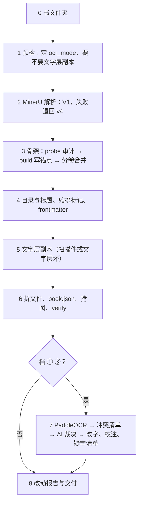

# lunzhu2md：现代出版物 PDF 导入

目标：正文可核对、可检索、可引用。导入只做一次：MinerU（+ PaddleOCR）重建出 Markdown 之后，修改都在 Markdown 里做，不再回头改识别结果的 JSON。

锚点、frontmatter `pdf`、书文件夹、`book.json`、疑字清单链接的格式只以 [references/anchors.md](references/anchors.md) 为准（仓库 `docs/anchors.md` 是同一份，改时两边同步）；Obsidian 插件 AIhistory PDF Sync 靠它配对、翻页。

命令一律在 PowerShell 里跑，写作 `python -X utf8 ${CLAUDE_SKILL_DIR}/scripts/<脚本>.py`。`${CLAUDE_SKILL_DIR}` 指本 SKILL.md 所在的目录：Claude Code 会自动替换；在 Codex 等别的平台上没被替换时，自己代入本文件所在目录的绝对路径（references 里的命令同理）。脚本 stdout 只打 ASCII 状态行，详细报告写进 `<书>/_数据/过程报告/`，用 Read 工具读。

## 〇、工作方式：脚本给证据，AI 做判断

- **脚本只做确定的机械活**：解析 MinerU、PaddleOCR 的结果，写锚点，校验，渲染页图，写文字层，按你给的裁决改字。遇到异常只报告，不自行改内容。
- **内容上的判断由你来做**：补不补、接不接、用哪份字、怎么改。把脚本的报告当证据、不当结论：对照原页图决定，并在校注里写明理由。拿不准就问用户，不猜。
- **不为少见情况往脚本里加自动修补规则**。碰到新情况，在对话里处理、写进校注，需要时向用户提出改流程。
- **能自动的只有三类半**：窄口径半全角（先定凡例，`punct_width.py`）、分卷纯拼接（`merge_skeletons.py`）、MinerU 明确标注的跨页合并（`build.py` 插锚点），以及用户确认过凡例后的标题级应用——这半类**尚未实现，由你按凡例手工做**，脚本只给建议。凡例确认后记进 `_数据/book.json` 的 `conventions`（格式见 [references/anchors.md](references/anchors.md) 第五节）。其余——推断的断段、期刊信息、疑误读页码、OCR 补空行——只报告。
- **拿得准但会改结构的（黄区）**：不改正文，打 `<!--?…-->` 标记写明打算怎么改，列进交付报告的「未判疑问」，等用户确认。
- **用户不在场或说“按推荐先做”**：只做点名范围内的最小改动；同页其他问题、跨页、标题层级另列，不顺手改。推荐不是授权。
- **每条内容改动都要有证据**：页码锚点 + 原图上的细节。指不出，就是没看原页。

全文见 [references/division-of-labor.md](references/division-of-labor.md)。

**怎么读报告**：每一步的报告（`_数据/过程报告/` 下的构建报告、合并报告，`_数据/文字层/文字层报告.md`，`_数据/冲突清单/冲突清单.md`）都分两类：脚本已经做了的机械活（抽查几处即可），和「交 AI 定」的候选（逐条处理）。候选处理完才往下走。

**什么时候看原页图**（Read 工具按页读 PDF，或 `crop_pdf.py` 裁图）：跨页断段接不接；没认出注号的注、整条漏的注；跨页表；章题、标题层级；疑误读、跳号的印刷页；文字层里空着的行；两家识别里只有一家读出的整段、结构冲突。只读文字就能定的（档 ① 的字冲突）不必看图。

**什么时候问用户**：要改原刊自身的误印；异体字、旧字形没定方针；看了原图仍拿不准；要多花钱（档 ③、再上传一次）；要上传计划外的文件。一次把同类问题攒齐了问，不逐条打断。用户不在场时，把同类问题攒成一张清单，按改错代价排序；不把“按推荐”当成全权。

## 一、开工先问两件事

**范围**：新导入、已有结果重建、还是只看几页。已有 PDF、MinerU 原始结果、PaddleOCR 结果的直接用，不重新上传。只读检查（比较、截图、定位）不改正文、不上传、不出全书报告。

**核字档位**：每次导入开工时用 AskUserQuestion 问一次（本书已定过的不再问）：

| 档 | 做法 | 花费 |
|---|---|---|
| ① 两家识别 + AI 读冲突清单（推荐） | 再交 PaddleOCR-VL 识别一遍，按页对齐出冲突清单；AI 只读文字裁字冲突，只有一家读出的整段、结构冲突才看原图 | 多一次 PaddleOCR 上传；AI 读文字，几百条冲突约几万字 |
| ② 只用 MinerU | 不交第二家；报告写明「无第二读者覆盖」 | 最省 |
| ③ AI 看图判 | 两家识别后，每条冲突都看原页图裁 | **耗费极高**：每页图要占大量上下文，三百页的书要几十万到上百万 token，问之前先把这个说清楚 |

档位只决定核字的深浅，前面的结构重建（脚注、标题、锚点）各档一样。

**问档位之前先查凭据**：跑 `paddle_api.py status`（不联网，退出码 3 = 未配）。用户想选 ① ③ 而令牌没配时，把它和档位放进**同一次提问**：

- 现在就配：按 [references/get-token.md](references/get-token.md) **一步步带他拿**（一次只给一步、卡住让他截图、令牌不进聊天）→ 配好再开工；
- 退档 ②（只用 MinerU），报告写明「无第二读者覆盖」；
- 先做结构重建，档位待定。

别等到第 7 步交第二家时才失败：那时档位已经定了，白跑一趟，还容易让人误以为只是小故障。详见 [references/paddleocr.md](references/paddleocr.md)。

## 二、导入流程



### 0. 书文件夹

```text
<书>/
├─ <原件>.pdf                 原件，只读
├─ <原件>.文字层.pdf          需要时
├─ 00-卷首.md、01-正文.md …   成品
├─ <书名>.md                  索引
├─ <书名>.AI校注.md           校注
├─ <书名>.疑字清单.md         档 ① 有未决项时
└─ _数据/  book.json  MinerU/  PaddleOCR/（原始结果，只读）  冲突清单/  过程报告/
```

输出位置照用户说的；没说就用 PDF 所在文件夹，或在它旁边建 `<书名>/` 把 PDF 复制进去（原件不移动、不改）。已有的书沿用原来的目录名。

### 1. 预检

```powershell
python -X utf8 ${CLAUDE_SKILL_DIR}/scripts/pdf_preflight.py <书>/<原件>.pdf --output <书>/_数据/过程报告/_preflight.json
```

读 `recommendedOcrMode`、`ocrModeReason`、`needsTextLayerCopy`，再抽看几页原图（目录、正文、注区、图表）。**显式**定 `ocr_mode`，不交 `auto`：中文书默认 `ocr`（MinerU 3.4.4 走文字层会吞中文标点，实测反例见 [mineru-api.md](references/mineru-api.md)）；扫描件必 `ocr` 并要做文字层副本。用户已说了的照用户的。

### 2. MinerU 解析

```powershell
python -X utf8 ${CLAUDE_SKILL_DIR}/scripts/mineru_v1.py submit <书>/<原件>.pdf -o <书>/_数据/MinerU --ocr-mode ocr
```

V1 为主（sha256 秒传、`ocr_mode`、`page_range`、`/v1/usage` 官方用量、`Idempotency-Key`），失败或产物结构不对自动退回 v4；要 `ocr` 却拿到文字层解析（`_ocr_enable: false`，实测同一文件第二次交 V1 时 `ocr_mode` 不起作用）也退回 v4。超过 200 页自动拆卷。报告里写明每卷用的是哪条接口。令牌用 `mineru_api.py configure` 本机存一次，绝不打印、不写进任何文件。细节见 [mineru-api.md](references/mineru-api.md)。

所有脚本读中间结构前先查 `schema`。MinerU 云端若改交 4.0（DocVortex）结构：**不停下**，`mineru_v1.py` 打出 `NOTICE_UPDATE_SKILL`、报告里 `update_skill_suggested: true`，这几卷自动改走 v4 接口继续导入；在交付报告开头提醒用户更新 skill（Claude Code 里 skill 随 aihistory1012 插件更新：`claude plugin marketplace update` 后 `claude plugin update`；别的平台重新复制 skill 文件夹）。只有 v4 也失败、或 v4 也交 4.0 结构（`build.py` 报 DocVortex 错误）时才停下，告诉用户当前版本读不了，要等 skill 更新。

### 3. 骨架

每卷先审计，再构建；拆卷的书再合并：

```powershell
python -X utf8 ${CLAUDE_SKILL_DIR}/scripts/probe.py <书>/_数据/MinerU/<卷>.mineru
python -X utf8 ${CLAUDE_SKILL_DIR}/scripts/build.py <书>/_数据/MinerU/<卷>.mineru -o <书>/_数据/过程报告/_skeleton1.md [--skip-marker 1,2] [--add-footnote 页序号:圈码序号:正文]
python -X utf8 ${CLAUDE_SKILL_DIR}/scripts/merge_skeletons.py <骨架1.md> <骨架2.md> -o <书>/_数据/过程报告/_skeleton.md
```

- `probe.py` 报正文圈码与脚注条数是否对齐。对不上先查清：非脚注的圈码（作者用 ⑧ 指前文编号 (8)、版权页罗马数字被认成 ①）用 `--skip-marker 全局序号`（序号看 `_markers.tsv`）；MinerU 整条漏掉的注，裁原图确认原刊确有，才用 `--add-footnote` 补。原刊本就有注号无注文的，照录、写校注。
- `build.py` 只做机械的：写每页一个 `<!--pdf-page.N-->`（分卷自动加起始页偏移），段落跨页时按 MinerU 自己的 `cross_page` 插在接缝处；后面紧跟按 MinerU 读到的页码推定的 `<!--p.M-->`；脚注定义写成 `[^n]: <!--pdf-page.N--><!--p.M--> 注文`；领起几个圈码的注（「②③⑥」）按圈码拆成几条、页内按圈码排序。脚注只还原标签，不改半全角。
- 构建报告里「交 AI 定」的候选逐条对原图处理，脚本都没动：
  - **疑似被换页切断、MinerU 没合并的段落**：是一段就接上，下一页锚点留在接缝处；不是就不动；别给上页末尾补句号。分卷接缝（`_merge_report.txt`）同样处理。
  - **开头没认出注号的脚注块**：注号漏识、上页注文续接，还是页下别的文字。
  - **期刊元信息**（骨架开头的 `<!--?meta-->`）：移进 frontmatter。
  - **标题层级**：报告只给按编号形态的建议，骨架保留 MinerU 的级别，层级按第 4 步定。
  - **疑似跨页表**：这一页的表格块是空的、续表被并进了上一页的表；数据定不了哪几行属于这一页，看原图把这一页的锚点挪进表里续表开始处，或照原样留着并写进校注。
  - **印刷页疑误读、跳号**：读到的数照写着，看原页改。
- 来源字段说明见 [mineru-outputs.md](references/mineru-outputs.md)（为什么必须从 `layout.json` 重建、脚注五个陷阱、标点丢失）。

### 4. 目录与标题、缩排标记、frontmatter

- 多级标题按 [toc-headings.md](references/toc-headings.md)：AI 看目录原页出候选标题树，核正文后再改 `#` 层级；MinerU 常把章题当页眉丢掉，看章首页原图补回。补回的标题放在该页锚点之后另起一段，锚点不写进标题行。
- `<!--?quote-->`、`<!--?center-->` 逐条对文字判：确是引文改成 `>`；题名、作者按本来身份；都不是删标记。
- frontmatter 从 `_probe.txt` 的页眉与骨架开头的 `<!--?meta-->`（`收稿日期`、`基金项目` 等）补，补完删掉这些标记；`tags`、`aliases`、`cssclasses` 键名必须英文。格式见 [templates.md](references/templates.md)。
- 空白页上模型编出来的英文（`verify.py` 报「长段拉丁文」）核原图后删，写进校注。
- 正文标点照原书；原书有标点而骨架缺的，按原图还原；脚注只清标签、不按文意补标点。
- 中文语境半角标点的统一是形式改动，可以交脚本，但先由用户定一条**凡例**（整本统一全角／保留原样），记进 `book.json` 的 `conventions.punctWidth`；定为全角才跑 `punct_width.py`（改前备份、整批报告），没定就照原样。脚注同样按凡例，不在构建时自动改。

  ```powershell
  python -X utf8 ${CLAUDE_SKILL_DIR}/scripts/punct_width.py "<书>/0*.md" [--dry-run]
  ```

### 5. 文字层副本（扫描件，或文字层坏的 PDF）

```powershell
python -X utf8 ${CLAUDE_SKILL_DIR}/scripts/paddle_lines.py submit <书>/<原件>.pdf -o <书>/_数据/PaddleOCR行框
python -X utf8 ${CLAUDE_SKILL_DIR}/scripts/pdf_textlayer.py assign --pdf <书>/<原件>.pdf --mineru <卷1>.mineru [--mineru <卷2>.mineru] --lines <书>/_数据/PaddleOCR行框/lines.json
python -X utf8 ${CLAUDE_SKILL_DIR}/scripts/pdf_textlayer.py fill --assignment <书>/_数据/文字层/assignment.json --page 85 --line 3 --text "…"
python -X utf8 ${CLAUDE_SKILL_DIR}/scripts/pdf_textlayer.py write --pdf <书>/<原件>.pdf --assignment <书>/_数据/文字层/assignment.json [--visible-text raster]
```

字用 MinerU 的，行框找 PaddleOCR 云端（PP-OCRv6）要；写成隐形文字存 `<原件>.文字层.pdf`，原件不动。

1. `paddle_lines.py` 找行（页面上传百度；扫描件档 ① 本来就交过 PaddleOCR，不新增暴露面；未刊稿等先问用户）。
2. `assign` 按 MinerU 的跨页标记把跨页段拆回各页，再把字对到行上，写 `_数据/文字层/assignment.json` 与 `文字层报告.md`。
3. 读报告，逐处定：**空着的行**（表格为主，也可能是 MinerU 漏行）、**放不进任何行的字**、**疑似跨页表**、**OCR 认的字与要写的字差得太远的行**（多半是空白页上模型编出的字，脚本没写进文字层）。报告附 OCR 自己认的字，只作参考，**不要直接拿来补**——实测专著第 84–85 页的表，四家识别都把同一个生僻字认成形近的常用字，OCR 还把「痾」认成「病」、「金沴木」认成「金诊木」。看原页后三选一：正文本身错了就先改正文（记校注），再按改好的字 `fill`；正文没有这几行就用核过的字 `fill`；拿不准或不值得的留空（写进交付报告）。
4. `write` 按分配表写副本。扫描页直接替换旧隐形层；字本来看得见的页默认原样保留，文字层坏了（复制出乱码、丢标点）才用 `--visible-text raster` 换成图再写字。看 `_textlayer_report.json` 的 `pagesBelow99`、`fontMissing`。

细节、行框文件格式、云端用不了时怎么办，见 [textlayer.md](references/textlayer.md)。要在拆文件之前做，`split_book.py` 才会把 frontmatter `pdf` 指向副本。

### 6. 拆文件、book.json、拷图、自检

```powershell
python -X utf8 ${CLAUDE_SKILL_DIR}/scripts/split_book.py <书>/_数据/过程报告/_skeleton.md -o <书> --meta book=<书名> --meta author=<作者> [--level 2] [--pdf <原件>.文字层.pdf]
python -X utf8 ${CLAUDE_SKILL_DIR}/scripts/copy_images.py <书>/_数据/MinerU <书>
python -X utf8 ${CLAUDE_SKILL_DIR}/scripts/verify.py --book <书>
```

- 图书：正文各章合成一份 `NN-正文.md`，卷首、书末各篇另存；论文 `--level 2`，整篇一份。用户明说要按章拆才 `--split`。看 `_split_report.txt` 确认序论、结语等没被分错。
- 每个文件 frontmatter 写 `pdf: "[[…]]"`（有文字层副本时指副本）；写 `_数据/book.json`（PDF、文件列表与各自的物理页范围、页码偏移）。
- `verify.py --book` 必须全过：每个文件有 `pdf`、物理页锚点连续单调、全书覆盖第 1 页到最后一页、每页恰好一个；脚注引用与定义一一对应；没有残留标签和待复核标记。

### 7. 两家识别（档 ① ③）

```powershell
python -X utf8 ${CLAUDE_SKILL_DIR}/scripts/paddle_api.py submit <书>/<原件>.pdf -o <书>/_数据/PaddleOCR
python -X utf8 ${CLAUDE_SKILL_DIR}/scripts/crosscheck.py --book <书> --vl <书>/_数据/PaddleOCR
python -X utf8 ${CLAUDE_SKILL_DIR}/scripts/doubts.py --book <书> --decisions <书>/_数据/冲突清单/decisions.json
python -X utf8 ${CLAUDE_SKILL_DIR}/scripts/verify.py --book <书>
```

`crosscheck.py` 按物理页锚点把 PaddleOCR 逐页结果与正文对齐，出冲突清单：1–4 字的字冲突；注号个数、脚注条数、标题、表格、整段有无等结构冲突。裁决规则、`decisions.json` 格式见 [crosscheck.md](references/crosscheck.md)，要点：

- **档 ①**：读冲突清单的文字裁字冲突；只有一家读出的整段、成片差异、结构冲突这几处看原图。档 ③ 全看原图。
- 能从文意、成句、典籍原文、专名确定的才定；两家都不对、两家都通、异体字形没定方针的，一律 `pending`，不猜。
- `doubts.py` 只改定位得到的字冲突，每处记进《<书名>.AI校注.md》；未决的写《<书名>.疑字清单.md》，条目带 `obsidian://aihistory-pdf-sync?...` 链接，点了在 Obsidian 里跳到原页、选中现字。

### 8. 改动报告与交付

```powershell
python -X utf8 ${CLAUDE_SKILL_DIR}/scripts/diff_report.py <书>/_数据/MinerU/<卷1>.mineru,<卷2>.mineru "<书>/0*.md"
```

剔除标点、空格、Markdown 语法后仍有的差异就是实质改动，逐条对得上校注才交付。交付报告见第五节。

## 三、保真规则

1. 以本次所据原件为准。OCR 错读、漏读按原图纠正；原刊自身误印、疑脱字照录并列疑问，未经用户许可不改成「应有」的文字，不用别的版本补正文。
2. 原书有标点照录，无标点不补；不按语言模型的文意补标点。
3. 原有夹注、附注、缺字框和难以转录的内容不丢弃。
4. 字形方针先查本书记录（校注 frontmatter 的 `异体字方针`），本次需要新决策时才问。替换都要有原图依据并记校注。比对时的字形折叠不等于改正文。
5. 内容层修改逐处记录原字、改字、位置和依据；校注与正文分开，改动报告由脚本生成。
6. 两家读法不一致只是线索，一致也不证明无误。未经整页或整书核验，不报全书准确率；只有一家读者时，报告注明没有第二读者覆盖。
7. 模型输出、脚本推断、已核原图的事实三者分开标明。

## 四、页码口径

| 标记 | 含义 |
|---|---|
| `<!--pdf-page.N-->` | PDF 物理页（从 1 起），每页恰好一个，正文里连续、单调。**主锚点** |
| `<!--p.M-->` | 印刷页，紧跟在物理页锚点后；按 MinerU 读到的页码推定，待核项列在构建报告里 |

- 两种口径不混称。说「第 N 页」时写明是 PDF 第 N 页还是原书 p.M。
- 目录上的页码是印刷页，不是物理页。缺页、页码跳变要核原件，不自动补成连续；推不出印刷页的页（封面、扉页）只有物理页锚点。
- 从原 PDF 抽出几页测试或重跑时，锚点仍写原 PDF 的页号（`mineru_v1.py --page-range` 与 `build.py` 已按此处理）。
- 一页跨两个文件时，后一个文件开头有一个「续页锚点」（与前一文件最后的锚点相同，`split_book.py` 自动补）；这是唯一允许的重复。
- 页首就是章标题时，物理页锚点在标题前独占一行，印刷页锚点可以留在标题后。
- 扫描件本身页序乱的照实写原 PDF 页号，`verify.py` 只提示倒序；旧数据、外来笔记缺页时用 `verify.py --allow-gaps`。新导入的书不加，缺页就是问题。

## 五、服务、凭据与交付

**服务与凭据**：PDF 会上传到 MinerU（及档 ① ③ 的 PaddleOCR／百度）服务器；只向本次任务已授权的服务上传，用缓存完成的不上传，未刊稿、有保密顾虑的材料先问。密钥不贴进聊天、不写进仓库、不进命令行参数；缺凭据时让用户本机跑对应脚本的 `configure`。第二家的令牌状态用 `paddle_api.py status` 查（开工时就查，见第一节），配法、配额、失败处理见 [references/paddleocr.md](references/paddleocr.md)；**带用户拿令牌的话术见 [references/get-token.md](references/get-token.md)**（用户不懂 AI 也照此走，MinerU 必配、PaddleOCR 可选）。

**不擅自删除**下载文件、原始结果、备份、过程报告或用户资料。

**交付分两份写，给不同的人**：

1. `_数据/过程报告/_交付报告.md`——过程与核验数据，留档用。清单见下。
2. **对话里的交付**——写给拿到书的人，不是写给运维。三步，顺序不能换：

   - **拿到什么**：几页、哪些篇、注在不在、和原件对不对得上，一句能复述；
   - **能不能信**：改了几处、依据是什么（举两三个最能说明问题的例子，如「效顰」「齗齗」）；哪几处拿不准、你该怎么核；
   - **哪里要自己核**：没做到的明说——没看页图、没有第二读者、哪些页只是抽样。

   术语只在需要用户判断处出现，出现就当场换成日常说法（锚点→「每页的隐形书签」；冲突清单→「两家识别读得不一样的地方」）。见 [delivery.md](references/delivery.md)。

**交付前把成品当书读一遍。** `verify.py` 全绿只证明锚点连续、脚注对得上，不证明成品可读：段落被并、标题归错、表格串行都不会让它报警。至少读开头两页、每章首页、一处跨页接缝，再交付。

`_交付报告.md` 的内容：

- 处理的页与未处理的页；用了哪条接口、`ocr_mode`、有没有退回 v4；核字档位；
- 物理页锚点覆盖（`verify.py --book` 结果）、印刷页待核项；
- 目录与标题的对应情况；脚注条数与引用对齐情况；图表；
- 文字层副本（有无、哪些页换成了图、最低回读匹配）；
- 两家识别：第二家令牌状态（`status` 结果）、比对页数、无第二读者覆盖的页、各类冲突条数、已改几处（依据读文字还是看图）、未决几处（疑字清单路径）；
- 改动及依据、未判疑问和缺口。

只做了抽样的写明是抽样，不说成全书校订完成；接口调用成功不等于校订完成。**没拿到的能力（没有图像输入、第二家令牌没配）写进「哪里要自己核」，不能略过。**
